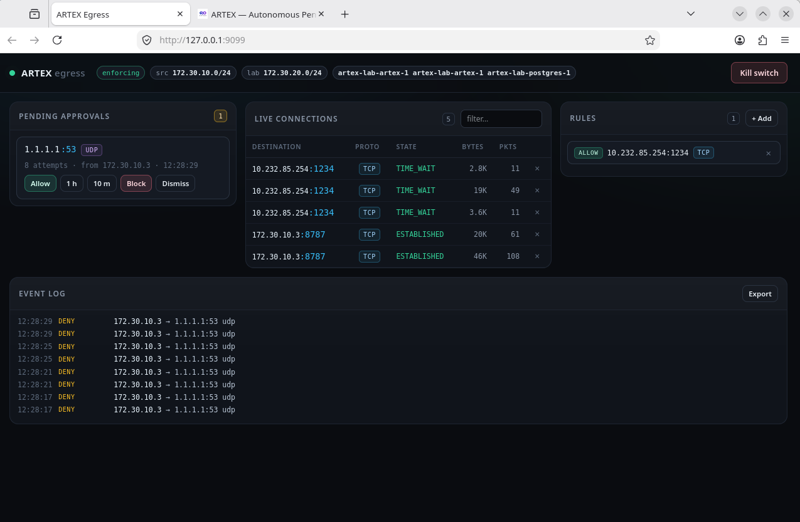

# ARTEX Cage

ARTEX Cage is a Linux tool that runs ARTEX containers behind a configurable
network boundary. It uses Docker, nftables and conntrack to control outbound
traffic and provides a browser console for observing and approving destinations.
A dedicated machine or VM is recommended.

Use ARTEX only against systems you own or are explicitly authorized to test.

> **Reboot warning:** Docker can restart containers before the cage restores its
> firewall rules. Reboot startup is not currently a fail-closed boundary.

## Contents

- [How it works](#how-it-works)
- [Requirements](#requirements)
- [Installation](#installation)
  - [Installer options](#installer-options)
  - [First-time setup](#first-time-setup)
  - [Project files](#project-files)
- [Egress console](#egress-console)
- [Model servers and DNS](#model-servers-and-dns)
- [Lab targets](#lab-targets)
- [Operations](#operations)
- [Security limitations](#security-limitations)

## How it works

The supplied Compose configuration creates two Docker networks:

- **Egress (`artex0`, `172.30.10.0/24`):** ARTEX and PostgreSQL. Forwarded
  traffic from this subnet is denied by default, except for the lab network and
  approved destinations.
- **Lab (`lab0`, `172.30.20.0/24`):** an internal network for ARTEX and optional
  targets. ARTEX can reach lab targets without an egress approval.

The egress daemon applies the firewall rules and serves the console on
`127.0.0.1:9099`. ARTEX's UI is on `127.0.0.1:8787`. Both bind to the Linux
host's loopback interface.

## Requirements

- A Linux host running **Debian 12+ or Ubuntu 22.04+**, systemd, and a kernel
  with nftables, bridge-family nftables and conntrack support. The installer
  uses `apt`; other distributions are not supported by it.
- Root or `sudo`; Docker Engine **28.0+**, Compose **2.33+** and buildx. The
  installer installs missing components and starts Docker, but does not remove
  conflicting packages or automatically upgrade an older installation.
- Internet access for apt, the ARTEX checkout and image builds; available subnets
  `172.30.10.0/24` and `172.30.20.0/24`; free loopback ports 8787, 8788 and
  9099. The installer also installs nftables, conntrack, git, curl, Python 3,
  ca-certificates, kmod and procps if missing.
- Approximately 4 CPUs, 8 GB RAM and 20 GB disk space; a reachable model
  provider; and a browser on the Linux host or a secure tunnel to it.

Docker must run on the same Linux kernel as the cage; Docker Desktop is not the
intended deployment. Installing Docker may add its
[official apt repository](https://docs.docker.com/engine/install/).

## Installation

From the checked-out project directory:

```bash
sudo ./install.sh
```

The installer prepares the cage, clones ARTEX, builds and starts the containers,
and prints a summary and the first-run setup token when available. It can prompt
for an OpenAI-compatible model server; answering no leaves model setup for later.
Non-interactive installs skip the prompt. Existing `.env` files are preserved.

### Installer options

| Command | Effect |
| --- | --- |
| `sudo ./install.sh` or `sudo ./install.sh --up` | Install prerequisites and the cage, then build and start ARTEX. |
| `sudo ./install.sh --no-up` | Install prerequisites and the cage without building or starting ARTEX. |
| `sudo ./install.sh --allow-model [HOST:PORT]` | Authorize a private model-list endpoint and recreate ARTEX; prompts if omitted. The egress daemon must be running. |
| `sudo ./install.sh --uninstall` | Remove the daemon, state and event log, and attempt to remove firewall tables. Configuration, containers and volumes remain. |
| `./install.sh --help` | Show the options. |

**Before uninstalling, run `docker compose down`.** Uninstalling removes the
cage but does not stop the containers. It keeps `/etc/artex-lab` and the project
directory, but removes `/var/lib/artex-egress`.

### First-time setup

1. Open **http://127.0.0.1:8787/setup** and enter the setup token from the
   installer summary. Choose an ARTEX password.
2. Configure a model and credentials in ARTEX. Approve its destination in the
   egress console when it appears; see [Model servers and DNS](#model-servers-and-dns).
3. Run `./verify-isolation.sh` from the project directory. It checks selected
   connectivity assumptions; it does not verify every possible traffic path,
   DNS isolation or the kill switch.

Until a password is set, ARTEX generates a new token on each container start.
If the installer did not capture it, check the latest startup log:

```bash
docker compose logs artex | grep -o 'Setup token for the /setup page: .*' | tail -n 1
```

If accessing the host remotely, use a secure tunnel to its loopback ports rather
than exposing the console publicly. Local access to the console can control
egress.

### Project files

- [.env.example](.env.example) shows configuration examples. The installer
  copies it to `.env` on first install; edit `.env` to set your own values.
- [docker-compose.yml](docker-compose.yml) defines the containers, networks,
  DNS settings and mounts. The installer uses it automatically; edit it to add
  lab targets or adjust container settings.
- [egress/config.example.json](egress/config.example.json) supplies the initial
  egress daemon settings. The installer copies it to `/etc/artex-lab/egress.json`
  only if that file does not exist. To change an existing installation, edit
  that file and restart the daemon with `sudo systemctl restart artex-egressd`.
  Network subnets and bridge names must match the Compose configuration.
- [tests/test_install.py](tests/test_install.py) contains installer regression
  tests. It is not needed to run the cage, but is useful when changing the
  installer. Run it with `python3 -m unittest discover -s tests -p test_install.py`;
  these tests do not replace Linux firewall or Docker integration testing.

## Egress console



The example shows a DNS request awaiting approval and an allowed model
destination. The addresses shown are examples, not required configuration.

- **Pending approvals:** observed denied destinations. Allow permanently, for
  one hour or ten minutes; block explicitly; or dismiss an entry.
- **Live connections:** tracked connections and counters; `×` deletes a
  conntrack entry.
- **Rules:** add or remove IP/protocol rules. TCP and UDP rules include a
  destination port; ICMP rules use an IP address.
- **Event log:** observed decisions, including blocked container-to-host
  attempts. Kernel logging is rate-limited, so this is not a complete packet
  capture.

Removing or expiring an allow rule, or adding a block, rechecks outbound packets
against the rules and attempts to flush matching conntrack entries.

The **kill switch** places drops ahead of established-connection rules, covering
the cage and lab networks, and attempts to flush their conntrack entries and
pause their containers. Releasing it resumes containers it paused. Pausing can
be disabled with `killswitch_pause` in `/etc/artex-lab/egress.json`; see the DNS
and reboot limitations below.

## Model servers and DNS

ARTEX's model-list API requires an explicit allowlist entry for private
endpoints. If the UI says `endpoint URL host is not allowed`, run:

```bash
sudo ./install.sh --allow-model 192.168.1.10:1234  # replace with your host and port
```

An HTTP(S) URL also works. This adds the exact host and port to
`ARTEX_LLM_PRIVATE_ENDPOINTS` in `.env`, preserving existing entries, and
recreates ARTEX. It does not create an egress rule: enter the matching URL in
ARTEX (for example, `http://192.168.1.10:1234/v1` for an OpenAI-compatible
server) and separately approve the destination in the console.

The Compose services use `1.1.1.1` as their explicit DNS upstream. External
queries remain blocked until that destination is approved (UDP port 53, and TCP
port 53 if needed). Approval sends DNS queries to Cloudflare; change the `dns`
entries in [docker-compose.yml](docker-compose.yml) to use another resolver.
Docker's embedded resolver continues to resolve container names.

Any additional container attached to the cage networks must also have an
explicit DNS setting. The kill switch reports an error if its point-in-time
inspection finds a running container without one or cannot inspect Docker.
Containers added later with unsafe DNS settings can bypass that check.

## Lab targets

Add authorized targets to the internal `lab` network in
[docker-compose.yml](docker-compose.yml), for example:

```yaml
  juice-shop:
    image: bkimminich/juice-shop
    dns: [1.1.1.1]
    networks: [lab]
    cap_drop: [ALL]
    pids_limit: 512
```

Start it with `docker compose up -d juice-shop`. The lab network has no external
gateway; ARTEX can reach its targets without an approval.

## Operations

```bash
docker compose ps                        # container status
docker compose logs -f artex             # ARTEX logs
sudo systemctl status artex-egressd      # daemon status
sudo journalctl -u artex-egressd -f      # daemon logs
sudo nft list table inet artex_egress    # active firewall rules
sudo nft list table bridge artex_egress  # kill-switch bridge rules
```

Rules and kill-switch state are stored in `/var/lib/artex-egress/state.json`;
the audit log is `/var/lib/artex-egress/events.jsonl`. Stopping the daemon leaves
its firewall tables in place. After updating this project, run
`sudo ./install.sh --no-up` to install the new daemon and service unit.

## Security limitations

- The cage controls configured container networks, not all traffic on the Linux
  host. Containers share the host kernel; a dedicated, snapshotted VM adds a
  separate boundary.
- The firewall works with IP addresses, protocols and ports, not application
  content. An approved service can carry other traffic, including DNS-encoded
  data. Only TCP, UDP and ICMP have GUI rules; other forwarded IPv4 protocols
  from the egress subnet are denied by default.
- Docker DNS can bypass the cage for containers without explicit upstream DNS
  configuration. The kill-switch DNS check is not continuous.
- Firewall rules are not retained across host reboot, and Docker may start
  containers before the daemon reapplies them. A daemon restart on a running
  host is different: the existing nftables tables remain loaded.
- Protect and back up `keys/`, which contains ARTEX's key material. ARTEX's own
  scope, interception and budget controls are additional safeguards, not
  substitutes for network isolation.
